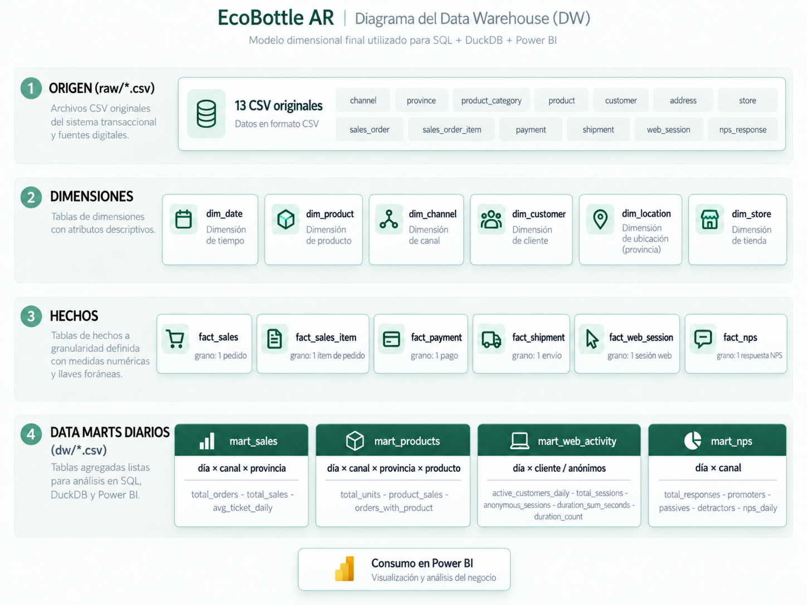
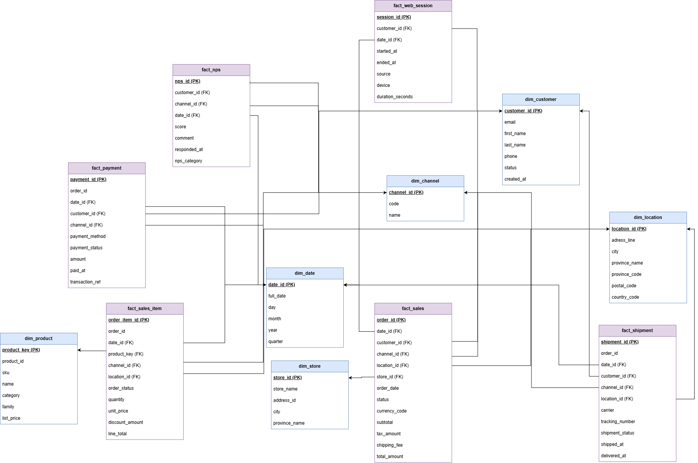
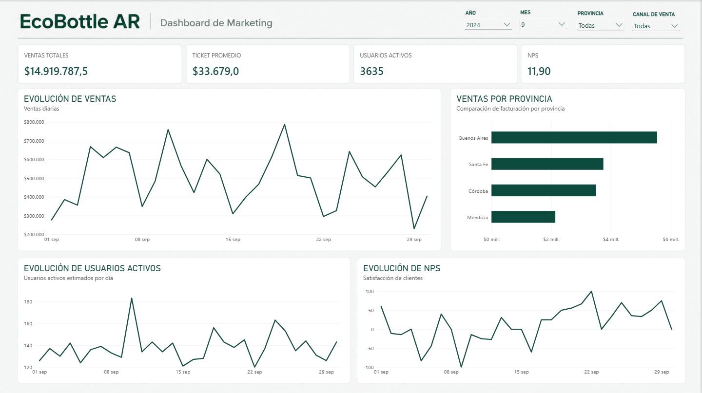
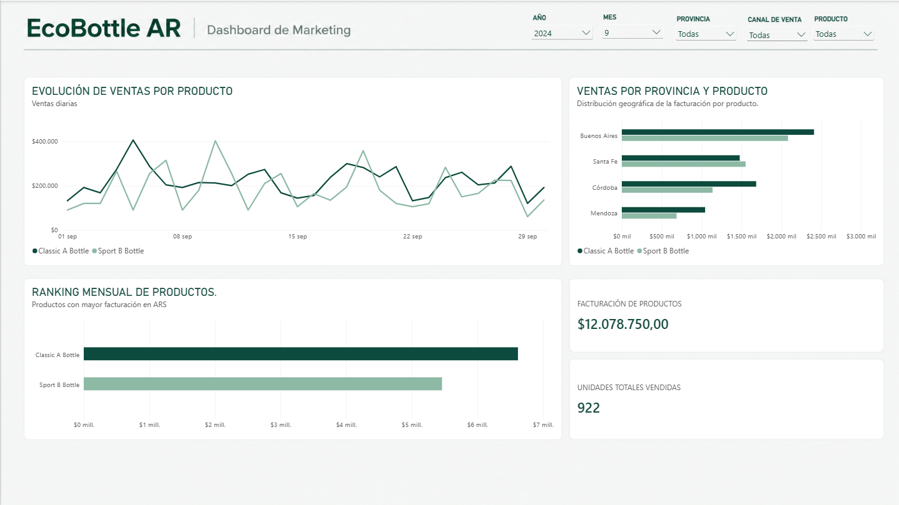
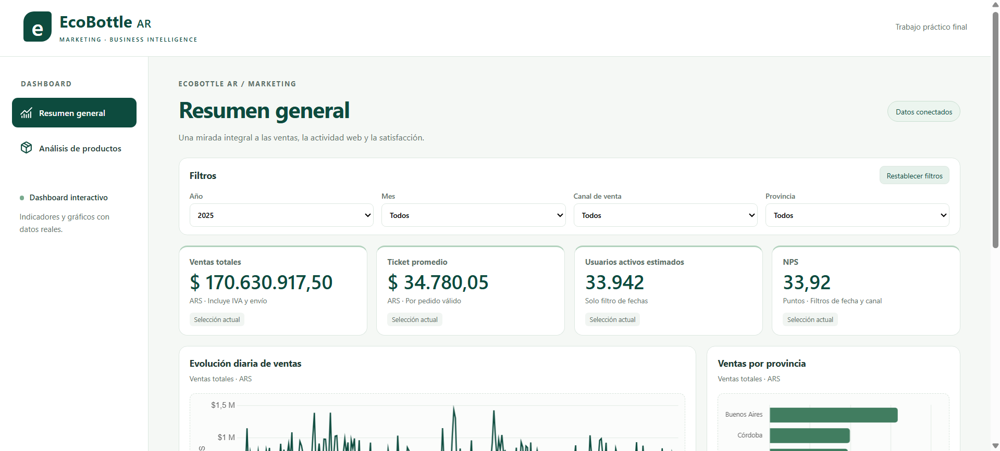

# EcoBottle AR — Trabajo Práctico Final de Marketing

Proyecto de análisis de ventas, actividad web y satisfacción de clientes de **EcoBottle AR**, desarrollado mediante un **Data Warehouse dimensional implementado con DuckDB y SQL**.

La solución incluye dos herramientas de visualización que utilizan los mismos cuatro Data Marts:

- **Power BI:** dashboard principal del trabajo práctico, con indicadores comerciales, análisis temporal y segmentadores.
  📊 [Descargar informe de Power BI](./power_bi/EcoBottle_AR.pbix). El archivo contiene las dos páginas del dashboard y puede abrirse con Power BI Desktop.

- **Dashboard web:** implementación interactiva complementaria desarrollada con HTML, CSS y JavaScript, publicada mediante GitHub Pages.
  🌐 [Acceder al dashboard web interactivo](https://micaelagermi04.github.io/practica-imond/). Permite explorar los indicadores desde cualquier navegador, sin necesidad de instalar aplicaciones.

Ambas herramientas permiten analizar ventas, ticket promedio, actividad web estimada, NPS y desempeño comercial por canal, provincia y producto.

**Consigna de referencia:** [Marketing — TP Final](https://docs.google.com/document/d/1JCgZyAsmyaqTePgWyQQglX3ybYk7dVXykSRPnhQdoSg/edit?tab=t.0).

**Período cubierto por los datos:** 1 de enero de 2024 al 30 de septiembre de 2025.  
**Fecha de corte de la fuente:** 30 de septiembre de 2025, 23:59:59.  
**Moneda:** pesos argentinos (ARS). Las fechas y horas corresponden a Argentina.

## 1. Objetivo

Construir una solución reproducible de Business Intelligence que permita conocer la evolución de las ventas de EcoBottle AR, el ticket promedio, la actividad web estimada, el NPS y el desempeño comercial por canal, provincia y producto.

El trabajo diferencia tres capas:

1. **Origen (`raw/`)**: archivos CSV originales.
2. **Transformación y modelado (`sql/`)**: dimensiones, tablas de hechos y cuatro Data Marts diarios, generados con DuckDB.
3. **Presentación (Power BI)**: indicadores, gráficos y segmentadores sobre las tablas exportadas en `dw/`.

### Arquitectura general del proyecto

El siguiente diagrama resume las cuatro capas del flujo analítico: **13 CSV originales**, **seis dimensiones**, **seis tablas de hechos** y **cuatro Data Marts diarios**, cuyos resultados se utilizan en Power BI. Es un diagrama de **arquitectura**, no un mapa de claves foráneas; las relaciones del modelo dimensional se documentan en la sección 4.



## 2. Organización del repositorio

```text
raw/                   13 CSV originales de EcoBottle AR
sql/
  01_dimensiones.sql   creación y carga de dimensiones
  02_hechos.sql        creación y carga de hechos
  03_marts.sql         cuatro Data Marts diarios
  04_consultas.sql     consultas de validación y análisis
run_sql.py             ejecución del pipeline SQL y exportación
requirements.txt       dependencias de Python, incluido DuckDB
dw/                    CSV generados al ejecutar el pipeline
generator/             generador de los datos de ejemplo (no es necesario ejecutarlo)
assets/                DER original, arquitectura DW y modelo dimensional
```

## 3. Fuentes de datos

EcoBottle AR es un caso con datos simulados de comercio digital y tiendas físicas. Cada CSV se consulta desde DuckDB bajo el esquema `raw`.

| CSV                    | Contenido                                |
| ---------------------- | ---------------------------------------- |
| `channel.csv`          | Canales `ONLINE` y `OFFLINE`             |
| `province.csv`         | Cuatro provincias de operación           |
| `product_category.csv` | Categorías y familias de producto        |
| `product.csv`          | `Classic A Bottle` y `Sport B Bottle`    |
| `store.csv`            | Tiendas físicas                          |
| `customer.csv`         | Clientes                                 |
| `address.csv`          | Direcciones                              |
| `sales_order.csv`      | Cabeceras de pedidos, estados e importes |
| `sales_order_item.csv` | Ítems de pedido, cantidades y precios    |
| `payment.csv`          | Pagos                                    |
| `shipment.csv`         | Envíos                                   |
| `web_session.csv`      | Sesiones de navegación                   |
| `nps_response.csv`     | Respuestas de encuestas NPS              |

**Diagrama de origen (DER):** 

### Reglas originales relevantes

- Pedido **ONLINE**: no tiene `store_id`.
- Pedido **OFFLINE**: tiene tienda asociada; la dirección de envío utilizada para la operación puede ser la de la tienda.
- Una sesión web sin `customer_id` es una sesión anónima.
- Una respuesta NPS puede ser anónima y **no posee `order_id`**.

## 4. Modelo dimensional

Se utiliza modelado dimensional de **Kimball**, con dimensiones compartidas por varias tablas de hechos.
Este diagrama representa las seis dimensiones y seis tablas de hechos del DW, con sus atributos y relaciones. No incorpora los Data Marts en el mismo diagrama para conservar la legibilidad: la capa de Marts se describe a continuación y aparece en la figura de arquitectura de la sección 1.



### Dimensiones (`01_dimensiones.sql`)

| Dimensión      | Contenido principal                               |
| -------------- | ------------------------------------------------- |
| `dim_date`     | Fecha, año, mes, trimestre y claves de calendario |
| `dim_product`  | Producto y atributos de categoría/familia         |
| `dim_channel`  | Canal de venta                                    |
| `dim_customer` | Cliente                                           |
| `dim_location` | Dirección y provincia                             |
| `dim_store`    | Tienda física                                     |

### Hechos (`02_hechos.sql`)

| Hecho              | Grano (qué representa cada fila) |
| ------------------ | -------------------------------- |
| `fact_sales`       | Un pedido                        |
| `fact_sales_item`  | Un ítem de pedido                |
| `fact_payment`     | Un pago                          |
| `fact_shipment`    | Un envío                         |
| `fact_web_session` | Una sesión web                   |
| `fact_nps`         | Una respuesta de encuesta        |

### Data Marts definitivos (`03_marts.sql`)

Se eligió **un Mart diario por área de análisis**. Power BI puede agrupar las métricas aditivas por mes y utilizar medidas específicas para las no aditivas.

| Mart                | Grano                                                                | Campos principales                                                                                                        |
| ------------------- | -------------------------------------------------------------------- | ------------------------------------------------------------------------------------------------------------------------- |
| `mart_sales`        | Día × canal × provincia                                              | `total_orders`, `total_sales`, `avg_ticket_daily`                                                                         |
| `mart_products`     | Día × canal × provincia × producto                                   | `total_units`, `product_sales`, `orders_with_product`                                                                     |
| `mart_web_activity` | Día × cliente identificado; un grupo adicional por día para anónimos | `customer_id`, `active_customers_daily`, `total_sessions`, `anonymous_sessions`, `duration_sum_seconds`, `duration_count` |
| `mart_nps`          | Día × canal                                                          | `total_responses`, `promoters`, `passives`, `detractors`, `nps_daily`                                                     |

**Advertencias de granularidad:**

- `avg_ticket_daily` y `nps_daily` son informativos para un día. **No** se suman ni se promedian directamente para obtener el KPI mensual.
- `orders_with_product` no puede sumarse entre distintos productos para obtener la cantidad de pedidos únicos: un pedido puede incluir ambos.
- Los clientes identificados que navegan varios días deben contarse **una sola vez en el período seleccionado**.

## 5. Diccionario de indicadores y reglas de negocio

### Estados y fechas

- **Pedidos válidos:** exclusivamente `PAID` y `FULFILLED`. Se excluyen `CREATED`, `CANCELLED` y `REFUNDED`.
- Los pedidos reembolsados se excluyen completos: la solución **no** modela una devolución negativa en la fecha del reembolso.
- Las ventas y líneas se asignan a `order_date`.
- La actividad web se asigna a `started_at`.
- El NPS se asigna a `responded_at`, que puede ser posterior a la compra.
- La provincia corresponde a la **dirección de envío vinculada al pedido**.

### Indicadores comerciales

| KPI                              | Definición                                                                                                      | Fuente          |
| -------------------------------- | --------------------------------------------------------------------------------------------------------------- | --------------- |
| **Ventas totales**               | `SUM(total_sales)` de pedidos válidos; incluye importe neto de productos, IVA y envío                           | `mart_sales`    |
| **Cantidad de pedidos**          | `SUM(total_orders)` de pedidos válidos                                                                          | `mart_sales`    |
| **Ticket promedio**              | `SUM(total_sales) / SUM(total_orders)` del período seleccionado                                                 | `mart_sales`    |
| **Facturación de productos**     | `SUM(product_sales)`; líneas después de descuentos, **sin IVA ni envío**                                        | `mart_products` |
| **Unidades vendidas**            | `SUM(total_units)`                                                                                              | `mart_products` |
| **Ranking mensual de productos** | Orden descendente de `SUM(product_sales)` dentro del mes seleccionado; ranking por **importe**, no por unidades | `mart_products` |

La facturación de productos se calcula con `line_total = quantity × unit_price − discount_amount`. El importe del pedido incluye además `tax_amount` (IVA del 21 % del subtotal) y `shipping_fee`:

```text
total_amount = subtotal + tax_amount + shipping_fee
subtotal = SUM(line_total de los ítems del pedido)
```

Por eso, **Ventas totales y Facturación de productos no deben dar el mismo resultado**. La primera es una métrica de cabecera con IVA y envío; la segunda es una métrica de líneas netas de descuentos.

### Actividad web

**Usuarios activos estimados** = `DISTINCTCOUNT(customer_id no nulo)` en el período + `SUM(anonymous_sessions)`.

- Cada cliente identificado se cuenta una sola vez en el período completo.
- Cada sesión anónima se trata como una **unidad estimada** porque no se dispone de un identificador único del visitante.
- No debe interpretarse como número exacto de personas únicas.
- La suma de los valores diarios de usuarios puede ser mayor que el valor mensual porque un cliente identificado puede visitar varios días.
- Sin datos verificables de canal de compra, provincia y producto para todas las sesiones, los filtros de esas dimensiones **no aplican** al indicador web.

### NPS

```text
Promotores: puntajes 9–10
Pasivos:    puntajes 7–8
Detractores: puntajes 0–6

NPS = 100 × (SUM(promoters) − SUM(detractors)) / SUM(total_responses)
```

- Se cuentan **respuestas**, incluidas respuestas anónimas, no clientes únicos.
- El NPS del período es una **razón de sumas**. No se promedian los NPS diarios.
- Si no hubo respuestas para un día, el KPI es **BLANK (sin datos)** y no cero.
- El NPS puede filtrarse por canal y fecha, pero no se atribuye de forma verificable a producto ni provincia.

## 6. Dashboard de Power BI

El informe tiene **dos páginas**, ambas alimentadas por los cuatro Marts definitivos.

### Página 1 — Resumen

- Tarjetas: **Ventas totales**, **Ticket promedio**, **Usuarios activos estimados** y **NPS**.
- Series temporales: **Evolución diaria de ventas**, **Evolución diaria de usuarios activos estimados** y **Evolución del NPS**.
- Comparación: **Ventas por provincia** mediante barras, para las ventas generales.
- Segmentadores: Año, Mes, Canal de venta y Provincia.
  

### Página 2 — Análisis de productos

- Tarjetas: **Facturación de productos** y **Unidades vendidas**.
- **Ranking mensual por importe de ventas**.
- **Evolución de facturación por producto**.
- **Ventas por provincia y producto**.
- Segmentadores: Año, Mes, Canal, Provincia y Producto.
  

### Modelo y filtros del informe

Las **siete tablas del modelo Power BI** son:

- `dim_date` (importada del DW).
- `dim_channel_filter` y `dim_province_filter` (dimensiones auxiliares de valores únicos creadas en Power Query, para permitir filtrar los indicadores.).
- `mart_sales`, `mart_products`, `mart_web_activity` y `mart_nps`.

Relaciones de uno a varios y filtro en una única dirección, **desde la dimensión hacia los Marts**:

| Dimensión                            | Marts que filtra                      |
| ------------------------------------ | ------------------------------------- |
| `dim_date[date_id]`                  | Los cuatro Marts por `date_id` entero |
| `dim_channel_filter[channel_code]`   | Ventas, productos y NPS               |
| `dim_province_filter[province_name]` | Ventas y productos                    |

Los segmentadores de **Año y Mes** están sincronizados entre páginas. Las demás selecciones son independientes entre páginas.

### Medidas de referencia en DAX

Los importes y recuentos básicos se preparan en SQL. En Power BI se usan medidas para evaluar indicadores no aditivos sobre cualquier período seleccionado.

```dax
Ticket promedio =
DIVIDE(
    SUM(mart_sales[total_sales]),
    SUM(mart_sales[total_orders])
)

Usuarios activos =
CALCULATE(
    DISTINCTCOUNT(mart_web_activity[customer_id]),
    NOT ISBLANK(mart_web_activity[customer_id])
)
+ SUM(mart_web_activity[anonymous_sessions])

NPS =
DIVIDE(
    SUM(mart_nps[promoters]) - SUM(mart_nps[detractors]),
    SUM(mart_nps[total_responses])
) * 100
```

En NPS se omite el tercer argumento de `DIVIDE`: cuando no hay respuestas, el resultado es **BLANK**. En Ticket promedio, omitir el resultado alternativo también evita informar un ticket cero cuando no existen pedidos.

## 7. Dashboard web interactivo

Como complemento al informe de Power BI, se desarrolló una versión web interactiva que utiliza los cuatro Data Marts exportados por el proceso ETL.

**Acceso público:** https://micaelagermi04.github.io/practica-imond/


### Tecnologías utilizadas

- HTML5 y CSS3 para la estructura y presentación.
- JavaScript para la carga de datos, el cálculo de indicadores y la interacción.
- Chart.js para la representación gráfica.
- Archivos CSV generados por DuckDB como fuente de información.
- GitHub Actions y GitHub Pages para el despliegue automático.

### Funcionalidades

El dashboard incluye dos vistas:

**Resumen general:** ventas totales, ticket promedio, usuarios activos estimados, NPS, evolución temporal y comparación de ventas por provincia.

**Análisis de productos:** facturación de productos, unidades vendidas, ranking mensual, evolución de facturación y análisis por provincia y producto.

Se incorporan filtros interactivos, tablas de datos asociadas a los gráficos, un diseño adaptable a diferentes tamaños de pantalla y manejo de errores durante la carga.

### Consistencia de los indicadores

La versión web utiliza las mismas definiciones de negocio documentadas para el Data Warehouse y Power BI. Se respetan las reglas de granularidad y las limitaciones de filtrado de las fuentes de datos.

### Publicación

El sitio se publica mediante un workflow de GitHub Actions. Cada actualización incorporada a la rama `main` permite desplegar nuevamente el dashboard utilizando los archivos de `web/` y los cuatro CSV definitivos de `dw/`.

El dashboard es una visualización de datos simulados con fecha de corte fija y no representa información comercial en tiempo real.

## 8. Instalación y ejecución

Se requiere **Python 3.9 o superior** y las dependencias indicadas en `requirements.txt`.

```bash
# Desde la carpeta del repositorio
python -m venv .venv
```

Activación del entorno:

```powershell
# Windows / PowerShell
.\.venv\Scripts\Activate.ps1
```

```bash
# macOS / Linux
source .venv/bin/activate
```

Instalación y ejecución:

```bash
pip install -r requirements.txt
python run_sql.py
```

`run_sql.py` procesa los `.sql` por nombre, crea/regenera el Data Warehouse, muestra las consultas SELECT y exporta las tablas resultantes como CSV a `dw/`. También produce `dw/modelo_estrella.md` con el esquema generado.

Comandos de exploración del proyecto base:

```bash
python run_sql.py --explorar  # inspeccionar las tablas RAW
python run_sql.py --ui        # ejecutar el DW y abrir DuckDB para explorarlo
```

> Si `dw/` contiene archivos de los Marts mensuales de una versión anterior, conviene quitarlos manualmente. El modelo final **solo consume cuatro Marts**; las copias viejas podrían permanecer aunque se regenere el DW.

### Conectar Power BI

1. Abrir el informe Power BI incluido en el proyecto.
2. En **Transformar datos → Administrar parámetros**, establecer `RutaDW` con la **ruta absoluta de la carpeta `dw`** de la computadora donde se ejecute. Ejemplo: `C:\\ruta\\al\\proyecto\\dw`.
3. Las consultas CSV utilizan expresiones equivalentes a `File.Contents(RutaDW & "\\mart_sales.csv")`; cada Mart y `dim_date` lee su propio archivo.
4. Confirmar que los tipos sean correctos: `date_id` entero, `month_start` fecha, montos decimales. Los CSV utilizan punto decimal: cuando corresponda, convertir montos desde texto usando configuración regional **Inglés (Estados Unidos)**.
5. Seleccionar **Cerrar y aplicar** y luego **Inicio → Actualizar**.
6. Verificar que el informe carga sin errores y que funcionan los segmentadores.

## 9. Alcance y limitaciones

- Los datos son simulados, con fecha de corte fija; no es una conexión en vivo a un sistema transaccional.
- Las ventas incluyen IVA y envío, mientras que las ventas por producto excluyen ambos conceptos: no se deben mezclar sin conciliación.
- La exclusión de `REFUNDED` describe el estado final de los pedidos, no un flujo contable de devoluciones por fecha.
- Los usuarios activos son una **estimación** por falta de identificador de visitante anónimo.
- No hay relación verificable entre una encuesta NPS y una provincia, producto o pedido específico.
- El ranking requerido es por **facturación del mes**; las unidades son un análisis adicional, no el criterio principal del ranking.

## 10. Recursos adicionales del repositorio

- `assets/DER.png`: DER de los 13 archivos originales (incluido en el repositorio base).
- `assets/diagrama_general.png`: diagrama de arquitectura RAW → dimensiones → hechos → Data Marts → Power BI.
- `assets/modelo_dimensional.drawio.png`: diagrama de relaciones y claves de las dimensiones y los hechos.
- `dw/modelo_estrella.md`: esquema generado del Data Warehouse.
- `generator/`: programa que generó los datos simulados. **No debe ejecutarse para desarrollar el TP**, salvo que se quiera reproducir los archivos originales. Consulte `generator/README.md` para detalles.
